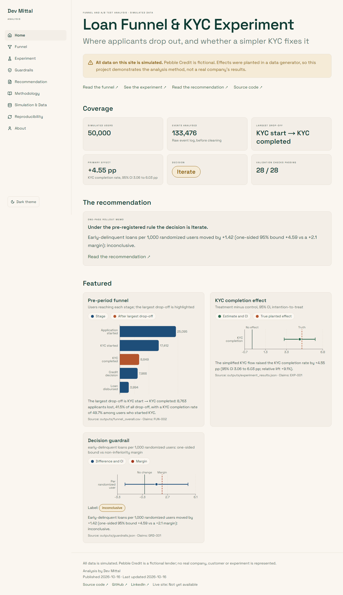
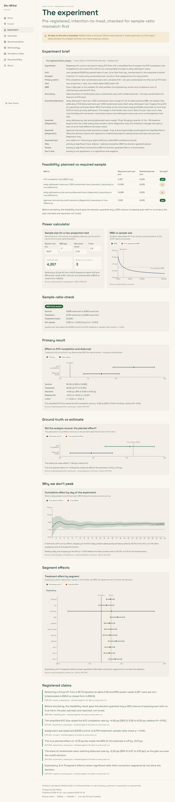
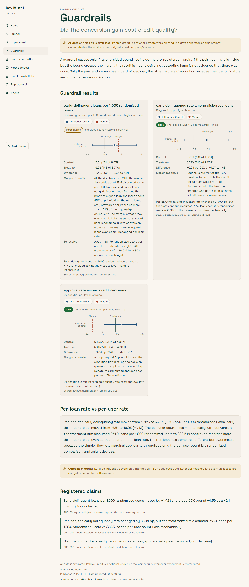

# Loan Funnel & KYC Experiment (simulated data)

End-to-end funnel and A/B test analysis on a **simulated** loan-application event log: find the leak in SQL, pre-register and analyse a simplified-KYC experiment, protect credit quality with non-inferiority guardrails, and decide under a rule frozen before any data existed.

**Site:** Not yet available (deploy pending) · **Author:** [Dev Mittal](https://github.com/Devvv2607) · [LinkedIn](https://www.linkedin.com/in/dev-mittal-99bb17302)

> **Simulated-data notice.** All data is generated by `src/simulate.py`. *Pebble Credit* is a fictional lender. Effects were planted in the generator, so this project demonstrates the analysis method and shows it recovers the planted truth. It is not a real company's result.

| Home | Experiment | Guardrails |
|---|---|---|
|  |  |  |

## Business question
Many applicants abandon the loan journey. Where is the biggest leak, does a simpler KYC flow fix it, and does any conversion gain come at the cost of worse credit quality?

## Simulation design
- 4-week pre-period (baseline funnel) + 4-week experiment; users randomized 50/50 by seeded hash at their first KYC start.
- Tables: `users`, `events` (application_started → kyc_started → kyc_completed → decision_made → loan_disbursed), `loans` (first-EMI 30+ DPD flag).
- Segment-varying conversion, day-of-week seasonality, log-normal stage gaps, legitimate KYC retries, and a **selection effect**: marginal applicants let through by the simpler flow are declined and go early-delinquent more often.
- Injected data-quality issues (duplicates, out-of-order timestamps, null devices, missing steps) with exact counts, plus a separate broken-assignment dataset used only to prove the SRM check works.
- Every parameter and its rationale: `config/simulation.yaml`.

## Funnel findings (pre-period)
- Of 25,095 simulated applicants in the pre-period, 3,994 reached loan disbursal (15.9% start-to-disbursal conversion).
- The largest drop-off is KYC start → KYC completed: 8,763 applicants lost, 41.5% of all drop-off, with a KYC completion rate of 49.7% among users who started KYC.
- The same stage is the largest drop-off in 13 of 15 segments (device, channel, city tier, week).
- Median time from KYC start to KYC completion is 46 minutes; the slowest 10% take over 230 minutes.

## Experiment design
- Pre-registration `config/experiment_brief.yaml`, frozen 2026-10-16T09:41:50Z (SHA-256 `5c98d4eec70f…`) **before data was simulated**; the analysis refuses to run if it is missing or edited.
- Primary metric: KYC completion rate = randomized users who complete KYC ÷ all users randomized into that arm at KYC start (intention-to-treat).
- Decision guardrail: early-delinquent loans per 1,000 randomized users, margin +2.1 derived by break-even unit economics from the business MDE and control-arm baseline rates only (no planted effects in the formula).
- Detecting a 3.0 pp lift from a 49.7% baseline at alpha 0.05 and 80% power needs 4,357 users per arm (statsmodels 4,356.8 vs closed form 4,356.9).
- Before simulating, the feasibility check gave the decision guardrail only a 30% chance of passing even with no true harm; the plan was kept and reported, not tuned.

## Results
- Assignment was balanced (8,639 control vs 8,740 treatment; sample-ratio check p = 0.44).
- **Primary:** The simplified KYC flow raised the KYC completion rate by +4.55 pp (95% CI 3.06 to 6.03 pp; relative lift +9.1%).
- **Ground truth:** The true planted effect of +4.76 pp lies inside the 95% CI; the estimate is off by -0.21 pp.
- **Secondary:** The share of randomized users reaching disbursal rose by +2.24 pp (95% CI 0.97 to 3.51 pp), so the gain survives the credit decision.
- **Decision guardrail:** Early-delinquent loans per 1,000 randomized users moved by +1.42 (one-sided 95% bound +4.59 vs a +2.1 margin): inconclusive.
- Per loan, the early delinquency rate changed by -0.04 pp, but the treatment arm disbursed 251.9 loans per 1,000 randomized users vs 229.5, so the per-user count rises mechanically.
- Diagnostic guardrails: early delinquency rate pass; approval rate pass (reported, not decisive).
- Exploratory: 9 of 11 segment effects remain significant after Holm correction; segments do not drive the decision.

## Decision and rollout plan
**Iterate.** Under the pre-registered rule the decision is Iterate.

- ✓ Primary metric significant (p = 2.0e-09 < 0.05)
- ✓ Primary effect positive (+4.55 pp)
- ✗ Decision guardrail passes non-inferiority (label: inconclusive)

Full one-page memo with the staged rollout plan, 30/60/90-day delinquency monitoring and rollback triggers: [`memo/recommendation.md`](memo/recommendation.md).

## Method validation
- Across 1,000 simulated A/A tests the false-positive rate was 4.9% (target 5%).
- 95.4% of 95% confidence intervals contained the true effect across 500 replications.
- The sample-ratio check flagged the deliberately broken dataset (48.3% treatment, p = 1.1e-05).
- Peeking daily and stopping at the first p < 0.05 inflated the false-positive rate to 24.7%, vs 4.7% at the fixed horizon.
- Cleaning removed exactly the 1,322 injected duplicates and kept all 5,085 legitimate KYC retries.
- Cross-stage validation: 28/28 checks passing (`outputs/validation_report.json`).

## Limitations
- **Simulated data:** demonstrates the method; real behaviour is messier.
- **Outcome maturity:** early delinquency covers only the first EMI; later losses are unobserved.
- **Novelty effect:** a short test may overstate a lift that fades.
- **Single experiment:** one run of one test; the validation simulations show how often a run like this would mislead.

## How to reproduce
```bash
python make.py setup      # or: make setup (Python 3.11 venv + requirements)
python make.py all        # simulate → … → validate → export-web
python make.py test       # pytest
cd web && npm ci && npm run lint && npm run typecheck && npm test && npm run build && npm run e2e
```
Seed 42 everywhere; two runs produce byte-identical outputs. `python make.py feasibility` and `src/brief.py` are one-off pre-simulation steps (the brief refuses to be overwritten).

## Structure
```
config/      simulation.yaml (ground truth) · experiment_brief.yaml (frozen) · settings.yaml
sql/         01_clean_events … 07_guardrails (DuckDB)
src/         simulate, ingest, clean, funnel, power, experiment, guardrails, segments,
             validation_sims, decision, claims, validate, export_web, readme
outputs/     aggregated CSV/JSON, claims registry, resume bullets (committed)
memo/        recommendation.md (generated)
tests/       pytest suites + Playwright screenshots
web/         Next.js static site (Vercel root directory)
```
